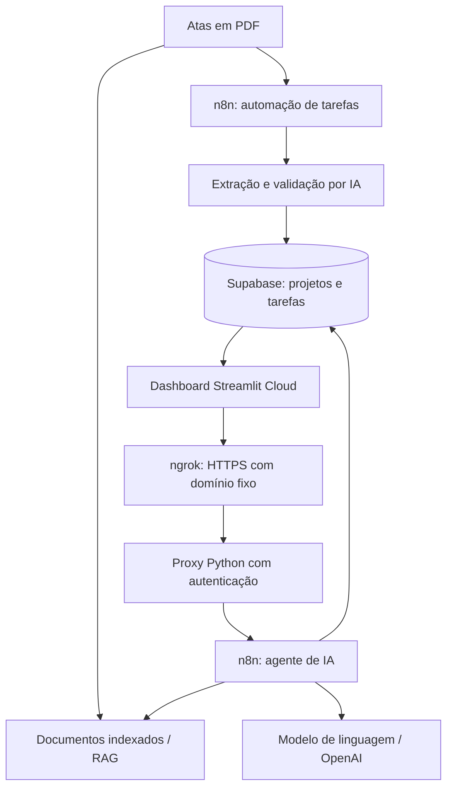

# SENAI Project Intelligence

**Automação de atas, agente de inteligência artificial e painel executivo para gestão de projetos.**

> Projeto desenvolvido como solução para um desafio técnico do SENAI. Trata-se de um protótipo demonstrativo, **não de um sistema oficial do SENAI**.

## Visão geral

O **SENAI Project Intelligence** integra **n8n**, **Supabase**, **OpenAI** e **Streamlit** para transformar informações dispersas em atas e bases de projetos em dados consultáveis e indicadores de gestão.

A solução está organizada em três entregas:

1. **Parte 1 — Automação:** interpretação de uma ata em PDF, identificação de tarefas, validação de vínculos com projetos e registro estruturado no Supabase.
2. **Parte 2 — Agente de IA:** respostas a perguntas em linguagem natural, combinando consultas ao banco de dados e recuperação de informações das atas (RAG).
3. **Bônus — Dashboard:** painel web para visualizar projetos, tarefas, indicadores financeiros, riscos e conversar com o agente.

## Demonstração e entregáveis

| Recurso | Acesso |
| --- | --- |
| Dashboard com assistente de IA | **[INSERIR A URL PÚBLICA DO STREAMLIT]** |
| Vídeo demonstrativo (até 4 minutos) | **[INSERIR LINK DO VÍDEO]** |
| Workflows exportados e demais arquivos | **[INSERIR LINK DA PASTA DO GOOGLE DRIVE]** |
| Código-fonte do dashboard | [GitHub — senai-project-intelligence](https://github.com/eloi120/senai-project-intelligence) |

**Para testar:** abra o dashboard, acesse **Assistente de IA** e faça uma pergunta, por exemplo: *“Quantos projetos existem cadastrados no SENAI?”*

> **Disponibilidade:** o dashboard está publicado no Streamlit Community Cloud, mas o agente depende de uma instância local do n8n, disponibilizada por um túnel HTTPS do ngrok. Por isso, respostas do agente exigem computador ligado, conexão com a internet e serviços locais ativos. O plano gratuito do túnel possui limites de uso. Consultas à API da OpenAI podem gerar custos.

## Arquitetura



### Tecnologias

| Camada | Tecnologia | Finalidade |
| --- | --- | --- |
| Orquestração | **n8n** | Fluxos de automação e agente de IA |
| Inteligência artificial | **OpenAI / LLM** | Interpretação de tarefas e respostas em linguagem natural |
| Dados | **Supabase / PostgreSQL** | Persistência e consulta de informações estruturadas |
| Documentos | **RAG + embeddings / Supabase Vector Store** | Recuperação semântica das atas |
| Aplicação | **Python + Streamlit** | Interface interativa do painel |
| Análise e gráficos | **Pandas + Plotly** | Indicadores, filtros e visualizações |
| Integração | **Webhook HTTP + proxy Python** | Comunicação entre Streamlit e n8n |
| Acesso externo | **ngrok** | Encaminhamento HTTPS para o proxy local |
| Versionamento | **Git e GitHub** | Organização e distribuição do código |

## Parte 1 — Automação de tarefas a partir de uma ata

**Objetivo:** transformar uma ata de reunião em tarefas estruturadas e registrá-las no banco, reduzindo transcrição manual e inconsistências.

**Fluxo implementado:**

1. Leitura do arquivo `Ata_08.pdf` pelo n8n.
2. Extração do conteúdo textual do PDF.
3. Análise do texto por um modelo de linguagem, identificando descrições, responsáveis e vínculos com a reunião/projeto.
4. Preparação e validação dos dados produzidos.
5. Consulta ao Supabase para verificar a existência do projeto referenciado.
6. Registro das tarefas válidas pela API REST do Supabase; tratamento de registros inválidos.
7. Proteção contra duplicações na inserção.

**Validação realizada:** o fluxo identificou e registrou **3 tarefas** da reunião `REU-241`, associadas ao projeto `PRJ-005`. O cenário de validação contava com **119 tarefas anteriores + 3 inseridas pela automação = 122 tarefas consolidadas**.

A política de idempotência utiliza uma restrição de unicidade da combinação `id_reuniao`, `descricao_tarefa` e `responsavel`, juntamente com inserção com tratamento de conflito. Assim, a reexecução do fluxo não deve duplicar a mesma tarefa com essa combinação.

**Artefato de entrega:** exportação `.json` do workflow da Parte 1, disponível na pasta de entrega.

## Parte 2 — Agente inteligente para consultas

**Objetivo:** permitir que pessoas consultem informações sobre projetos e reuniões sem precisar escrever SQL ou localizar manualmente os documentos.

O agente foi construído no **n8n** e utiliza ferramentas para buscar dados no Supabase, além de **RAG (Retrieval-Augmented Generation)** para consultar trechos das atas indexadas.

**Capacidades demonstradas:**

- Responder a perguntas sobre projetos, tarefas e responsáveis.
- Consultar informações estruturadas nas bases do Supabase.
- Recuperar contexto relevante de atas em PDF.
- Combinar informações documentais e dados do banco em respostas textuais.
- Ser acessado pelo próprio dashboard, por meio de um webhook protegido por chave de API.

**Dados do cenário de teste:** foram indexadas **8 atas**, divididas em **28 trechos** para recuperação semântica.

**Exemplos de perguntas para a avaliação:**

```text
Quantos projetos existem cadastrados no SENAI?
Quais tarefas estão vinculadas ao projeto Orion?
Quais riscos foram mencionados nas atas de reunião?
Quais responsáveis possuem tarefas pendentes?
```

> As respostas são produzidas pelo agente a partir dos dados e documentos disponíveis. Como em qualquer aplicação com LLM, resultados devem ser conferidos quando envolverem números, decisões ou informações críticas.

**Artefato de entrega:** exportação `.json` do workflow da Parte 2, disponível na pasta de entrega.

## Bônus — Dashboard executivo

O painel foi desenvolvido em **Streamlit** e reúne as seguintes áreas:

| Área | Funcionalidades |
| --- | --- |
| **Visão Executiva** | Resumo do portfólio e indicadores gerais |
| **Gestão de Tarefas** | Consulta e filtragem das atividades consolidadas |
| **Análise Financeira** | Indicadores e visualizações financeiras dos projetos |
| **Monitoramento de Riscos** | Riscos documentados, cruzamentos e identificação de inconsistências |
| **Assistente de IA** | Chat conectado ao agente n8n |

Além dos indicadores, a análise de riscos inclui verificação de divergências entre registros e informações documentadas. Nos testes realizados, foram identificados **7 riscos documentais**, **11 referências a tarefas**, **4 divergências de projeto** e **2 divergências de descrição**. Esses números correspondem ao conjunto de dados analisado e não devem ser interpretados automaticamente como ocorrências novas ou riscos ainda em aberto.

## Organização dos arquivos

Estrutura lógica sugerida para a entrega (os nomes dos JSONs podem variar conforme a exportação):

```text
senai-project-intelligence/
├── app.py                       # Interface Streamlit
├── database.py                  # Acesso e consultas ao Supabase
├── requirements.txt             # Dependências Python
├── webhook_proxy.py             # Proxy local autenticado (quando incluído)
├── .gitignore                   # Arquivos que não devem ser versionados
├── README.md                    # Esta documentação
└── .streamlit/
    └── secrets.toml             # Configuração LOCAL — NÃO publicar

entrega-senai/
├── video-demonstracao.mp4
├── parte-1-automacao.json
├── parte-2-agente-ia.json
└── links-de-acesso.txt
```

**Nota:** `webhook_proxy.py` é utilizado no computador que hospeda o n8n; não é necessário para quem apenas acessa o dashboard online.

## Execução local do dashboard

### Pré-requisitos

- Python 3.10 ou superior (recomendação de ambiente).
- Acesso a uma instância do Supabase com as tabelas/views esperadas pela aplicação.
- n8n com o workflow do agente ativo, caso queira usar o chat.
- Credenciais válidas configuradas localmente.

No Windows, abra o terminal do VS Code na raiz do projeto:

```powershell
py -m venv .venv
.\.venv\Scripts\Activate.ps1
python -m pip install -r requirements.txt
python -m streamlit run app.py
```

A aplicação costuma abrir em `http://localhost:8501`.

### Configuração de segredos

Crie o arquivo `.streamlit/secrets.toml` **somente no seu ambiente local**, com as variáveis usadas pelo projeto:

```toml
SUPABASE_URL = "https://SEU-PROJETO.supabase.co"
SUPABASE_KEY = "SUA_CHAVE_DO_SUPABASE"
N8N_WEBHOOK_URL = "http://127.0.0.1:5678/webhook/senai-agent-dashboard"
N8N_API_KEY = "SUA_CHAVE_PRIVADA_DO_WEBHOOK"
```

No **Streamlit Community Cloud**, configure os mesmos nomes em **Settings → Secrets**, ajustando `N8N_WEBHOOK_URL` para o endpoint HTTPS público do proxy (não para `localhost`).

**Nunca publique `secrets.toml`, tokens, senhas ou chaves de API no GitHub ou nos arquivos compartilhados com avaliadores.** Antes de disponibilizar um workflow n8n exportado, revise os parâmetros dos nós para evitar segredos inseridos diretamente em campos de texto.

### Proxy local e acesso externo ao agente

A integração online segue o caminho:

```text
Streamlit Cloud
    ↓ HTTPS
ngrok (domínio fixo)
    ↓
Proxy Python — 127.0.0.1:8765/senai-agent
    ↓ HTTP local + autenticação
n8n — /webhook/senai-agent-dashboard
    ↓
Supabase + documentos RAG + modelo de IA
```

O proxy recebe chamadas `POST` e valida o cabeçalho `X-SENAI-API-KEY` antes de encaminhá-las ao n8n. A interface administrativa do n8n **não é publicada diretamente pelo túnel**.

Em uma instalação equivalente, com o proxy presente, os processos podem ser executados por:

```powershell
.\.venv\Scripts\python.exe webhook_proxy.py
ngrok http 8765 --domain=SEU-DOMINIO-FIXO.ngrok-free.dev
```

No ambiente de demonstração, a inicialização do proxy e do ngrok foi configurada no **Agendador de Tarefas do Windows**. O Docker Desktop/n8n também precisa estar ativo, e o computador não deve entrar em suspensão.

> O endereço do dashboard pode permanecer estável mesmo quando o serviço local estiver fora do ar. Nesse caso, as páginas que consultam o Supabase ainda podem funcionar, enquanto o chat com o agente ficará indisponível.

## Segurança e limites da demonstração

- **Credenciais:** todas as chaves devem ficar em arquivos locais não versionados ou no gerenciador de segredos do serviço de hospedagem.
- **Banco de dados:** evite usar uma chave privilegiada do Supabase em ambientes públicos sem políticas e controles adequados. Use credenciais de menor privilégio e revise as permissões das views/tabelas.
- **Endpoint autenticado:** a chave do webhook não deve ser exposta ao navegador; as chamadas devem sair do backend Streamlit.
- **Custos:** o Streamlit e o ngrok podem operar dentro de limites gratuitos, mas o consumo da API da OpenAI pode ser cobrado.
- **Disponibilidade:** a instância do n8n e o proxy dependem do computador local. A demonstração não possui garantia de operação 24/7.
- **Abuso de consultas:** se o painel estiver aberto ao público, recomenda-se restringir acesso, limitar requisições e definir limites de gastos de API.
- **Privacidade:** os arquivos e dados compartilhados devem ser apropriados para avaliação e não conter informações confidenciais sem autorização.

## Critérios atendidos pela solução

| Item do desafio | Evidência |
| --- | --- |
| Automação de tarefas da Ata 08 | Workflow n8n e demonstração de gravação no Supabase |
| Agente de consulta às bases e atas | Workflow n8n, consultas ao banco, RAG e demonstração das respostas |
| Painel bônus | Aplicação Streamlit, indicadores e assistente integrado |
| Disponibilização para avaliação | Vídeo, exportações JSON, código-fonte e link público do dashboard |

## Observações finais

O objetivo deste projeto é demonstrar uma solução integrada e extensível, aliando **automação de processos**, **extração de informação com IA**, **persistência estruturada**, **recuperação semântica de documentos** e **visualização gerencial**.

O protótipo foi construído especificamente para demonstrar competências técnicas no desafio. Para uso contínuo em produção, seriam necessários testes adicionais de segurança, monitoramento, resiliência e governança dos dados.

---

**SENAI Project Intelligence — Desafio técnico | Outubro de 2026**
